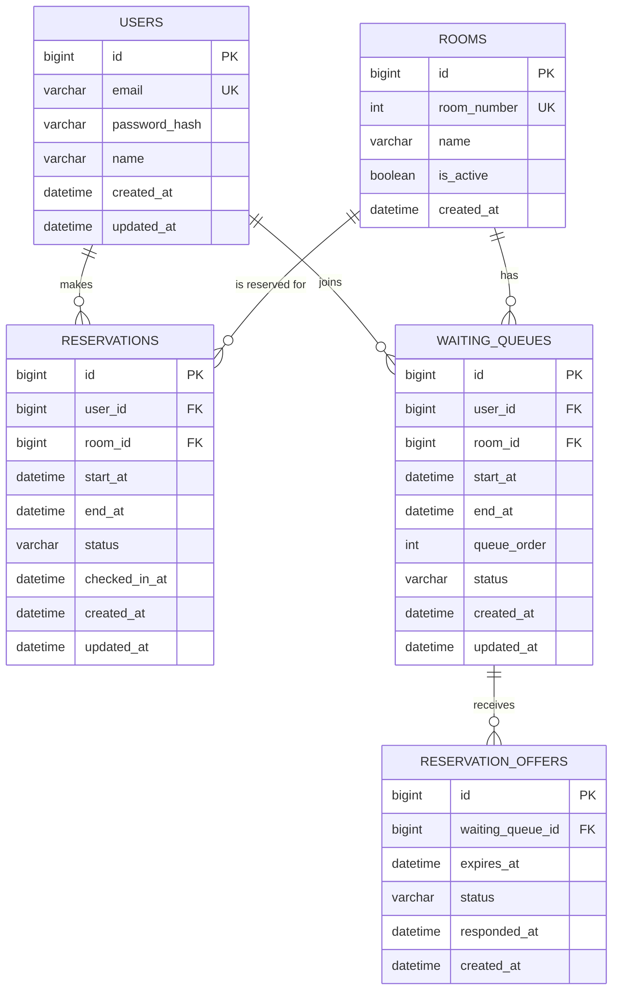

# RoomFlow ERD

다섯 테이블의 관계입니다. 팀은 예약 대표 사용자 1명으로 표현합니다.

## 제약과 인덱스

- users.email, rooms.room_number는 UNIQUE.
- waiting_queues의 (room_id, start_at, queue_order)는 UNIQUE. 취소된 순번은 재사용하지 않습니다.
- reservations의 방/사용자 + 시간 검색은 일반 인덱스. 취소 이력 때문에 단순 방·시작 또는 사용자·시작 UNIQUE를 두지 않습니다.
- reservation_offers의 (status, expires_at)는 만료 대상 조회용.
- 활성 예약·활성 대기 중복은 사용자/방 잠금 아래 서비스에서 검사합니다.
- 상태는 문자열로 저장합니다. DB 직접 쓰기는 서비스의 잠금·상태 전이 규칙을 우회하므로 금지하는 운영 규약이 필요합니다.
- 제안과 새 예약 사이의 직접 FK는 없습니다. 제안 수락 시 같은 트랜잭션에서 대기·제안 상태를 변경하고 해당 사용자·방·시간의 새 예약을 생성합니다.
- 시간은 DATETIME(6), 업무 해석은 Asia/Seoul입니다.

정확한 신규 설치 DDL은 [schema.sql](../SQL/schema.sql)을 참고하세요. ERD는 docs에 보관하고, 모델 변경 시 API 문서·DDL과 함께 갱신합니다.
